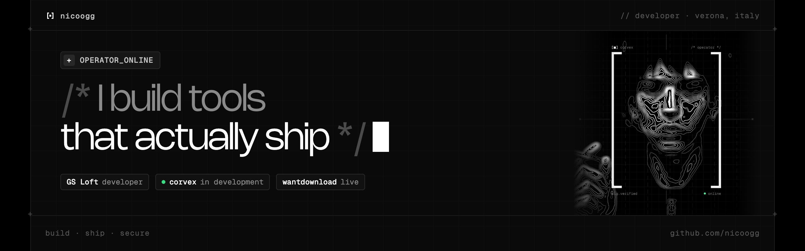

<p align="left"></p>

### `/*` Hi, I'm nicoogg `*/`

Developer based in Verona, Italy. I build web apps, internal tools and automations by day, and security software by night.

```text
$ whoami --verbose
role .............. developer
work .............. GS Loft · github.com/GS-Loft-Dev
building .......... corvex · security agents + corvexai (in development)
live .............. wantdownload · wantdownload.vercel.app
based in .......... Verona, Italy
```

### `/*` Work `*/`

I'm a developer at **GS Loft**. Our team's work lives in the [**GS-Loft-Dev**](https://github.com/GS-Loft-Dev) organization: internal portals, data tools, bots and integrations that keep the company running.

### `/*` Personal projects `*/`

| Project | Status | What it is |
|---|---|---|
| [**Corvex**](https://corvexdevelops.github.io/) | 🟢 in development | Security agents powered by **corvexai**, our own AI that runs locally. They test your dashboards, code and computer, find the gaps and fix them. Org: [CorvexDevelops](https://github.com/CorvexDevelops). |
| [**wantdownload**](https://wantdownload.vercel.app/app) | ✅ live | A web app to save YouTube videos as MP3 or MP4, with an account to find your downloads again. |

---

<sub>`// build · ship · secure`</sub>
