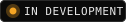

<p align="left"><a href="https://nicoogg.github.io"></a></p>

### `/*` Hi, I'm nicoogg `*/`

Developer based in Verona, Italy. I build web apps, internal tools and automations by day, and security software by night.

**Portfolio:** [nicoogg.github.io](https://nicoogg.github.io) ↗ — it's a shell. Click a command and it runs there:

<p>
<a href="https://nicoogg.github.io/#run=help"></a>
<a href="https://nicoogg.github.io/#run=neofetch"></a>
<a href="https://nicoogg.github.io/#run=projects"></a>
<a href="https://nicoogg.github.io/#run=git%20log"></a>
<a href="https://nicoogg.github.io/#run=scan"></a>
<a href="https://nicoogg.github.io/#run=matrix"></a>
</p>

<a href="https://nicoogg.github.io"></a>

### `/*` Work `*/`


I'm a developer at **GS Loft**. Our team's work lives in the [**GS-Loft-Dev**](https://github.com/GS-Loft-Dev) organization: internal portals, data tools, bots and integrations that keep the company running.

### `/*` Personal projects `*/`

| Project | Status | What it is |
|---|---|---|
| [**Corvex**](https://corvexdevelops.github.io/) |  | Security agents powered by **corvexai**, our own AI that runs locally. They test your dashboards, code and computer, find the gaps and fix them. Org: [CorvexDevelops](https://github.com/CorvexDevelops). |
| [**wantdownload**](https://wantdownload.vercel.app/app) |  | A web app to save YouTube videos as MP3 or MP4, with an account to find your downloads again. |

<details>
<summary><code>$ cat projects/corvex.md</code></summary>

<br>

**№01 corvex** · in development

Security agents powered by **corvexai**, our own AI that runs locally. 28 specialised agents test your dashboards, code and computer, find the gaps, explain them in plain language and fix them, or open a pull request for you to review.

→ [corvexdevelops.github.io](https://corvexdevelops.github.io/) · [CorvexDevelops on GitHub](https://github.com/CorvexDevelops) · [<code>open corvex</code> on the map](https://nicoogg.github.io/#run=open%20corvex)

</details>

<details>
<summary><code>$ cat projects/wantdownload.md</code></summary>

<br>

**№02 wantdownload** · live

A web app to save YouTube videos as MP3 or MP4, with an account to find your downloads again.

→ [wantdownload.vercel.app](https://wantdownload.vercel.app/app) · [<code>open wantdownload</code> on the map](https://nicoogg.github.io/#run=open%20wantdownload)

</details>

<details>
<summary><code>$ cat stack.txt</code></summary>

<br>

```text
languages ... Python · TypeScript · JavaScript · SQL
web ......... Next.js · React · Node · static sites that load fast
infra ....... Vercel · GitHub Actions · Supabase · Docker
security .... SAST, secrets, CVE matching, local AI (corvexai)
```

</details>

### `/*` Live activity `*/`

<a href="https://nicoogg.github.io/#run=git%20log"></a>

---

<sub>`// build · ship · secure` — psst: there's a hidden file on the portfolio. try <code>ls -a</code>.</sub>
